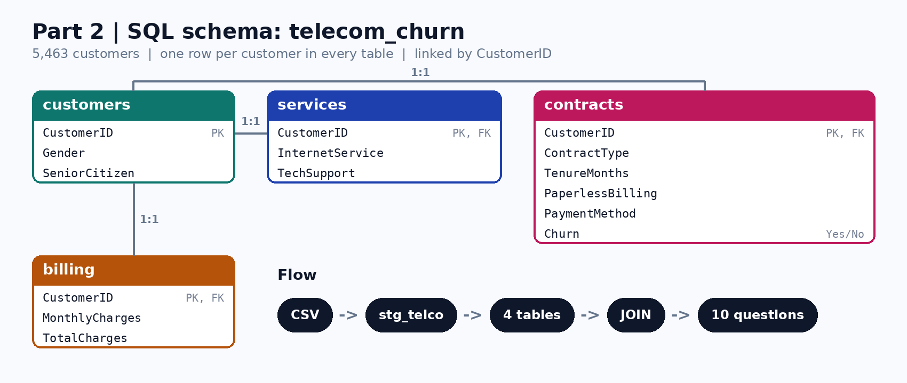

# Part 2: SQL Analysis | Telecom Customer Churn

> **The Churn Files, Part 2.** In Part 1 I found the churn problem with Python. In Part 2 I answer **10 business questions using only SQL**, and turn the answers into an action plan.

## Business problem
A telecom company loses about 1 in 4 customers. Where does the churn come from, how much money does it cost, and who should the retention team call first?

## Objectives
1. Build a relational database from the cleaned EDA data.
2. Find what drives churn using `JOIN`, `GROUP BY` and `CASE`.
3. Measure the revenue lost and the high-risk segment.
4. Give the retention team a clear call list.

## Data
The cleaned output of Part 1 (`data/telco_churn_cleaned.csv`): **5,463 customers**, 12 columns. It is loaded into a staging table and split into **4 linked tables**. Every table has one row per customer and is linked to `customers` by `CustomerID`:

| Table | What it holds |
|---|---|
| `customers` | Gender, SeniorCitizen |
| `services` | InternetService, TechSupport |
| `contracts` | ContractType, TenureMonths, PaperlessBilling, PaymentMethod, Churn |
| `billing` | MonthlyCharges, TotalCharges |
| `stg_telco` | Staging copy of the CSV (12 columns), used to fill the 4 tables |

The ER diagram was created in MySQL Workbench (`ER_Model.mwb`); `schema_diagram.png` is the picture of it.

## Files
| File | Purpose |
|---|---|
| `01_create_tables.sql` | Create the database, load the CSV, build the 4 tables |
| `02_data_quality_checks.sql` | 5 checks before the analysis |
| `03_business_questions.sql` | 10 business questions. Each one joins only the tables it needs, with a comment on what the answer means |
| `ER_Model.mwb` | MySQL Workbench model (open it in Workbench) |
| `schema_diagram.png` | ER diagram image |
| `Telecom_Churn_SQL_Project.pptx` | Presentation of the project |

## How to run (MySQL 8.0+)
1. Open **MySQL Workbench** and run `01_create_tables.sql` down to the `LOAD DATA HERE` marker. This creates the database and the empty staging table.
2. Load `telco_churn_cleaned.csv` into `stg_telco` with the **Table Data Import Wizard** (right-click the table). Steps for the `LOAD DATA` command are inside the file.
3. Run the rest of file 01, then file 02, then file 03.

**Check your setup:** you should see these results.

| Check | Expected |
|---|---|
| Rows in each table | 5,463 |
| Churned customers | 1,238 (22.7%) |
| High-risk segment | 335 customers, 39.1% churn |
| Month-to-Month + Fiber revenue lost | $42,601 a month |

## Data quality checks
- No duplicate customers and no missing values in key columns.
- **Finding:** `TechSupport` contradicts `InternetService` for **1,824 customers**: 871 customers with no internet have a Yes or No value, and 953 customers who do have internet are labelled "No Internet". In Q6, only customers with internet and a clear Yes or No are used.

## Key findings

| # | Question | Answer |
|---|---|---|
| Q1 | How big is the problem? | **1,238 of 5,463 customers left (22.7%)**, taking **$86,284 a month** (about **$1M a year**) |
| Q2 | Which contract loses most? | Month-to-Month **27.6%**, One Year **17.7%**, Two Year **14.7%** |
| Q3 | Is Fiber the problem? | Fiber **29.5%** churn (average bill $84) vs DSL **18.0%** ($58) |
| Q4 | Which payment method? | **Electronic Check 26.0%**; the other three are 21-22% |
| Q5 | When do customers leave? | **33.4%** in the first year, **14.3%** after 4 years |
| Q6 | Does Tech Support help? | **No.** DSL 18.2% vs 18.5%, Fiber 30.4% vs 29.3% |
| Q7 | Do age or gender matter? | **No.** All groups are between 21.5% and 24.5% |
| Q8 | Where does revenue leak? | **Month-to-Month + Fiber** loses $42,601 a month, far more than any other group |
| Q9 | Does SQL find the Part 1 segment? | **Yes.** 335 customers, **39.1% churn** vs 21.6% for everyone else, with **$17,138 a month** still active |
| Q10 | Who do we call first? | A top-20 list of active high-risk customers with above-average bills |

## What the business should do
1. **Move Month-to-Month Fiber customers to One-Year plans** with a small incentive. This group loses the most revenue.
2. **Focus on the first year.** One in three new customers leaves.
3. **Review Fiber pricing and value.** It has the highest churn and the highest bill.
4. **Encourage Electronic Check payers to switch to auto-pay.**
5. **Do not spend retention money on Tech Support.** The data shows no effect.
6. **Start the retention calls with the Q10 list.**

## SQL skills shown
`SELECT` · `WHERE` · `GROUP BY` · `HAVING` · `CASE` · `JOIN` (2 and 3 tables) · subquery · aggregate functions (`COUNT`, `SUM`, `AVG`, `ROUND`) · data quality checks · relational design with primary and foreign keys

## Notes and limitations
- "Revenue lost" means the monthly bill of customers who left. It is an estimate, not accounting revenue.
- Part 1 slides show 22.6% overall churn because the value was truncated; rounded to one decimal it is 22.7%.
- These results show patterns in the data, not proven causes.
- Written for MySQL 8.0+ using standard SQL, so it should work in most databases with small changes.

## Next: Part 3, Feature Engineering
Using what SQL found, I create new features for the machine learning models.

---
Author: **Shailesh Pawar** | [LinkedIn](https://linkedin.com/in/shaileshpawar-cse) | [GitHub](https://github.com/Shailesh-Pawar-18)
